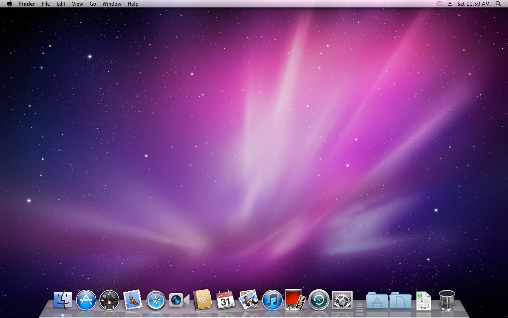
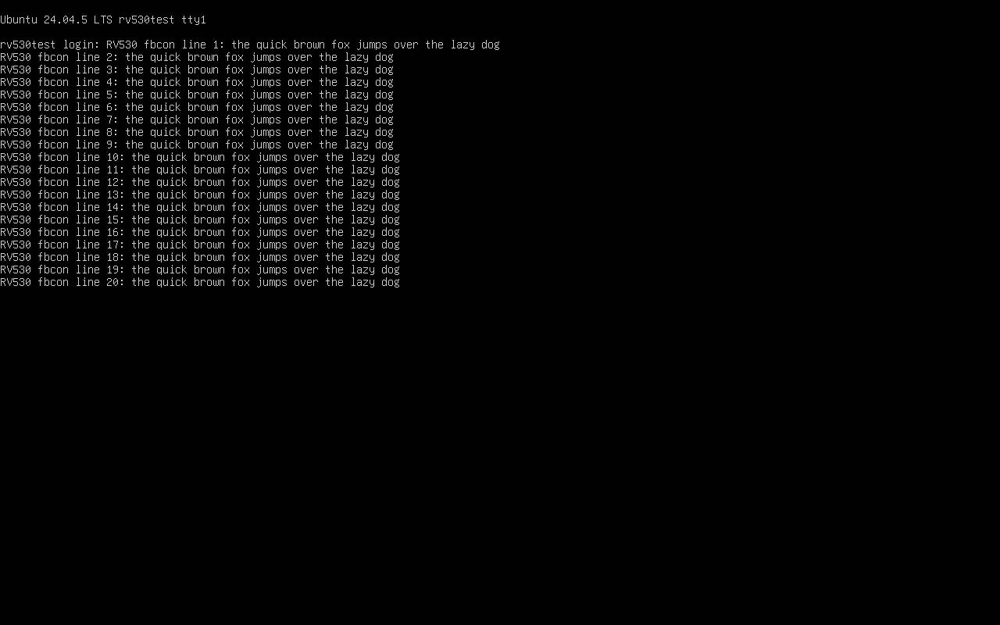
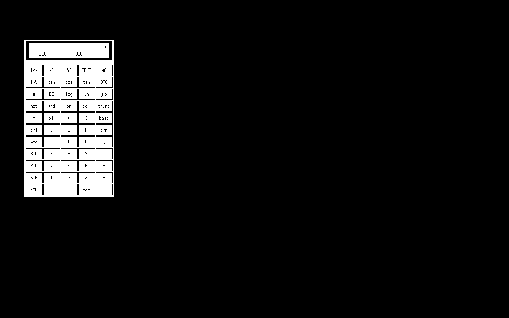
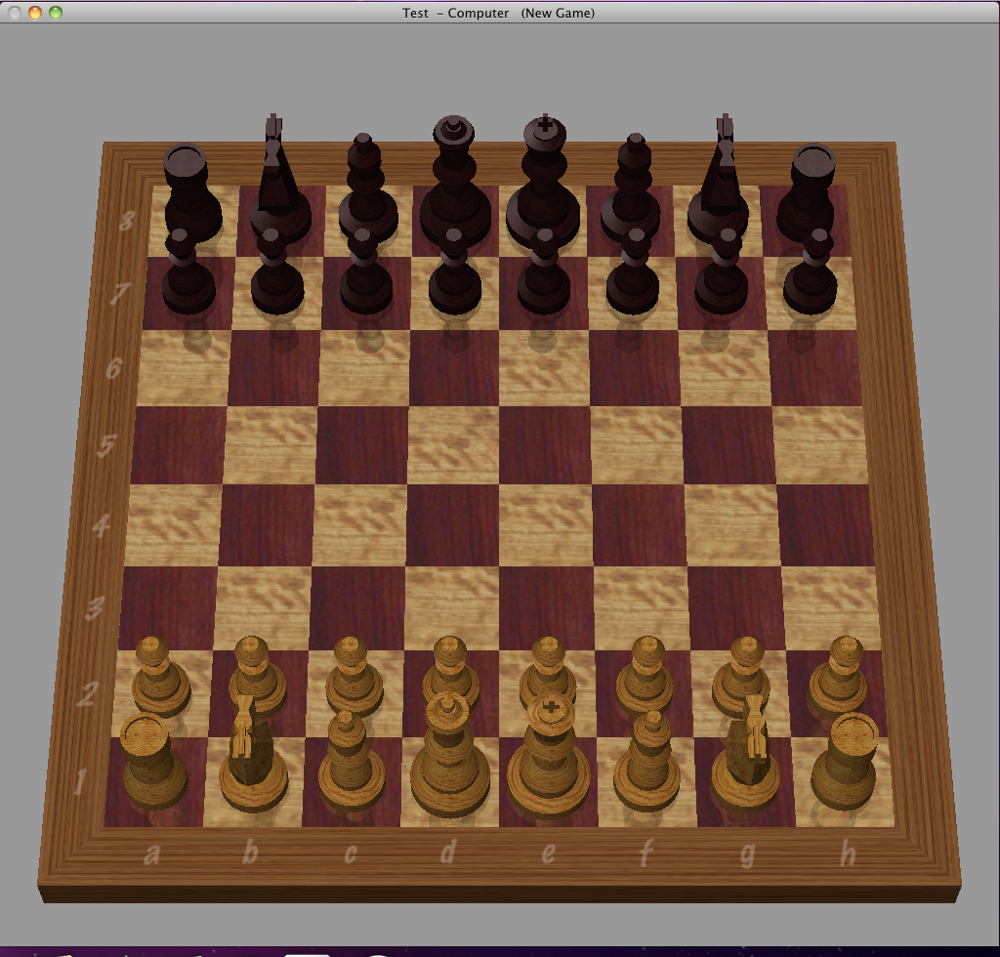
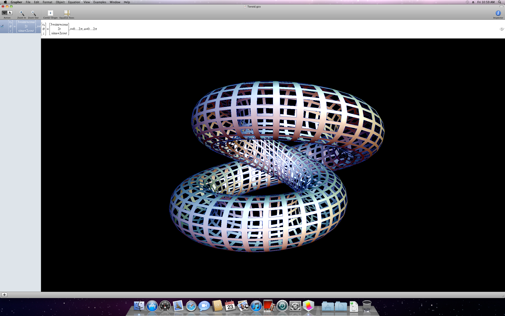
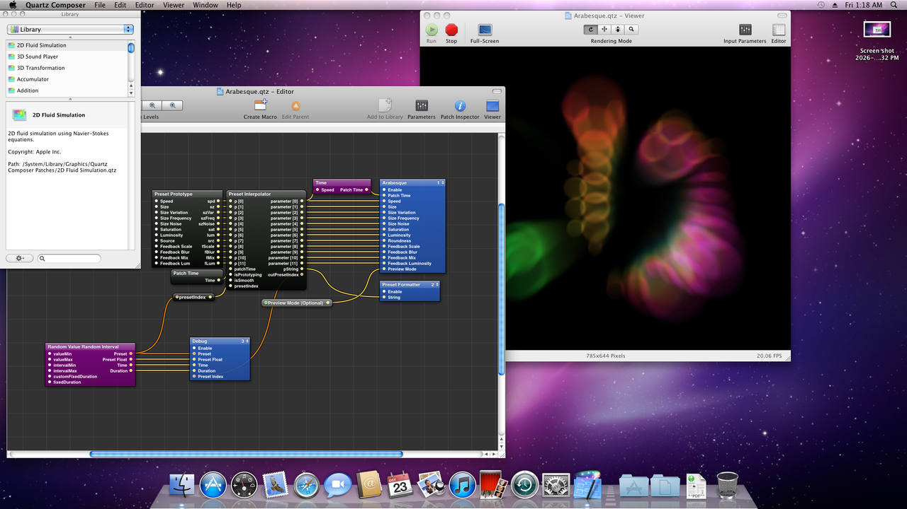
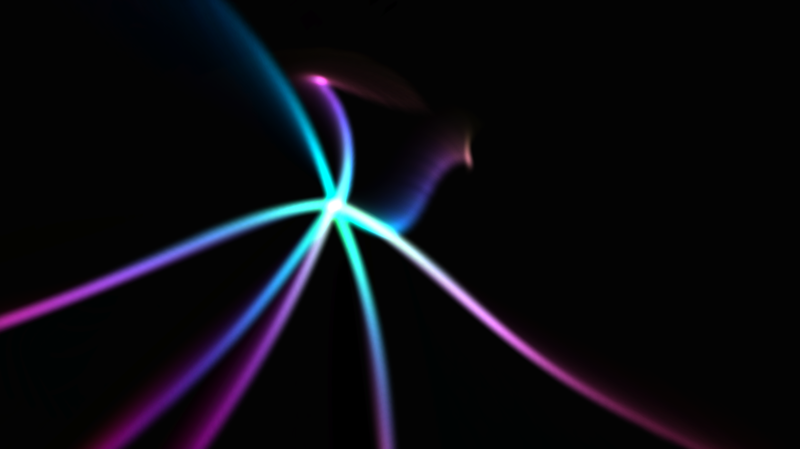
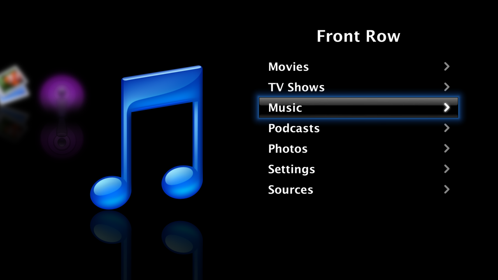
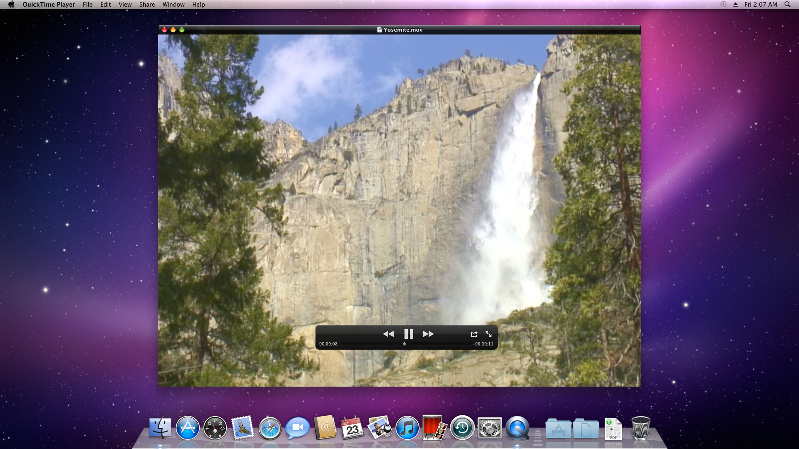

# rv530-qemu: Mac OS X Snow Leopard with GPU acceleration in QEMU

Run Mac OS X 10.6 (Snow Leopard) in a QEMU virtual machine with
**Quartz Extreme and Core Image enabled**, without GPU passthrough.

**[Read the wiki](https://github.com/CustomDrumDestroyer/rv530-qemu/wiki)** for
setup, installation, troubleshooting, and the FAQ.

The key piece is `rv530`, a QEMU display device that emulates an ATI Radeon
X1600 (RV530, R5xx family) closely enough for Apple's own, unmodified ATI
X1000 drivers to bind to it, 3D acceleration included. Nothing is installed
or patched in the guest. The command processor, 2D engine, vertex and
fragment programs, texturing, and scanout are all emulated. The 3D engine
has two implementations that share the same decoders:

- a **Vulkan backend** that runs rasterization, fragment programs,
  texturing, blending, and depth/stencil on the host GPU, and
- a **CPU reference path** (program interpreters and a software
  rasterizer), which takes the draws the Vulkan backend cannot.

Around the device, the repository has what a Snow Leopard VM needs: a
firmware graphics driver for the card, an OVMF build script, an OpenCore
boot-volume builder with the device properties Apple's driver expects, a
launcher, and an optional guest agent for drag and drop, clipboard sync, and
window-driven resizing.

## Host support

| Host | Guest runs under | Graphics | Status |
| --- | --- | --- | --- |
| x86_64 Linux | KVM | Vulkan on the host GPU | Reference host: fastest and most stable |
| Intel Mac | Hypervisor.framework | Vulkan on MoltenVK | Newer, less tested |
| Apple silicon Mac | TCG (emulated CPU, several times slower) | Vulkan on MoltenVK | Least stable |

## What works

In a Mac OS X 10.6.8 guest:

- **Desktop:** Quartz Extreme (translucency, shadows, Exposé, Dashboard, Cover
  Flow, Front Row) at up to 2560x1600.
- **Graphics apps:** OpenGL (Chess, Grapher, screen savers), Core Image
  filters, Quartz Composer, and QuickTime video.
- **Host integration:** sound, plus drag and drop, clipboard sync, and
  window-driven resizing with the optional guest agent.
- **Linux guests:** the in-kernel `radeon` driver (KMS, fbcon, X with EXA and
  3D compositing).

Known bugs are tracked in
[Issues](https://github.com/CustomDrumDestroyer/rv530-qemu/issues).

## Status

This is a **proof of concept and a work in progress**: see
[docs/STATUS.md](docs/STATUS.md) for per-module status and known gaps, and
[docs/DESIGN.md](docs/DESIGN.md) for the original design.

It was prepared with AI assistance and is provided as is, without warranty;
see [Disclaimer](#disclaimer).



The Mac OS X 10.6.7 desktop on the emulated X1600, composited by Quartz
Extreme: the translucent menu bar and the reflective 3D Dock are drawn through
the emulated GPU.

## Quick start

1. Build QEMU with the device: `scripts/setup-qemu.sh` (see Building below).
2. Follow [snowleopard/README.md](snowleopard/README.md): build OVMF and the
   OpenCore boot volume, install Mac OS X from your own install media with
   your own SMC key, then start it with `DISPLAY_MODE=rv530`.

No Apple software, Apple keys, or VBIOS images are included or needed from
this repository.

## What is here

| Path | Contents |
| --- | --- |
| `qemu/hw/display/rv530/` | The device model: a drop-in directory for QEMU 11.1.2 |
| `qemu/patches/0001-build-glue-rv530.patch` | Build glue (meson, Kconfig). Builds the Vulkan backend when the `vulkan` and `shaderc` pkg-config packages are found, and the CPU path only otherwise |
| `qemu/patches/0002-ui-input-last-abs.patch` | Lets a display device read the last absolute pointer position, which the device uses to recover the cursor hot spot |
| `qemu/patches/0003-ui-gtk-dnd.patch` | GTK UI: drag and drop of files to and from the guest agent |
| `qemu/patches/0004-ui-gtk-resize-toggle.patch` | GTK UI: **View → Resize Guest with Window** for devices with a run-time `auto-resize` property |
| `qemu/patches/0005-tcg-tsc-macos.patch` | TCG on Apple silicon: a nanosecond host tick source and a TSC scaled by `tsc-frequency` |
| `qemu/patches/0006-ui-cocoa-rv530.patch` | Cocoa UI (macOS hosts): drag and drop with the guest agent, View → Resize Guest with Window, window size in points |
| `qemu/patches/0007-rv530-metal-check-macos.patch` | macOS hosts: builds `r5xx_vk_mac.m`, which checks the Metal devices before MoltenVK is loaded |
| `qemu/patches/0008-hvf-log-clear-page-align.patch` | Hypervisor.framework (Intel Macs): page-aligns the dirty-log clear that std VGA makes unaligned, which QEMU 11.1.2 asserted on |
| `snowleopard/` | Everything for the Snow Leopard guest: launcher (with `host.sh`, which picks KVM, Hypervisor.framework, or TCG), install-image tool, OVMF build with the card's GOP driver, OpenCore boot-volume builder, tablet kext, guest agent, QMP control tool, in-guest tests ([snowleopard/README.md](snowleopard/README.md)) |
| `scripts/setup-qemu.sh` | Fetches QEMU 11.1.2, installs the device, applies the patches, builds QEMU and the option ROM |
| `scripts/atombios/mkrom.py` | Builds a synthetic, clean-room AtomBIOS option ROM for the device |
| `scripts/dnd/`, `scripts/agent-update.sh` | Host side of drag and drop and clipboard sync; installs the guest agent over ssh |
| `scripts/atomdis.py`, `scripts/regnames.py` | AtomBIOS command-table disassembler with register names (a debugging aid) |
| `scripts/fetch-references.sh` | Fetches the public reference sources the code was written against (Linux `radeon` driver files, Mesa 24.0.9) |
| `qemu/hw/display/rv530/tests/` | Unit tests: vertex programs (`pvs/`), fragment programs (`us/`), rasterizer (`raster/`), texture formats and sampling (`tex/`), and Vulkan-vs-CPU differential tests (`vk/`) |
| `qemu/hw/display/rv530/tools/mesa-rc/` | Wraps Mesa's r300/r500 shader compiler as a command-line tool, used as ground truth for the shader decoders |
| `docs/` | Design document, status, screenshots |

## Building

Hosts: Linux x86_64 with KVM (the reference), or a Mac (see "macOS hosts"
below). On Linux you need gcc, ninja, meson, python3, pkg-config, and the
glib, pixman, GTK 3, and libslirp development packages. For the Vulkan
backend you also need `libvulkan-dev` and `libshaderc-dev`, and a Vulkan 1.3
GPU with `VK_EXT_external_memory_host` and fragment shader interlock; 64-bit
floats are used when the GPU has them. It has been developed on NVIDIA
hardware. Mesa's software
Vulkan driver, lavapipe (`mesa-vulkan-drivers`), also has these features and
passes the Vulkan tests below, which is useful on hosts without a GPU, but it
is far too slow for a desktop guest.

On Ubuntu 24.04:

```
sudo apt install build-essential ninja-build meson python3 pkg-config libglib2.0-dev \
    libpixman-1-dev libgtk-3-dev libslirp-dev libpng-dev zlib1g-dev curl xz-utils \
    libvulkan-dev libshaderc-dev glslang-tools
scripts/setup-qemu.sh
```

This produces `build-qemu/qemu-11.1.2/build/qemu-system-x86_64` and the
option ROM `build-rom/rv530-atombios.rom`.

### macOS hosts

On an Intel Mac the guest runs under Hypervisor.framework, much as under
KVM. On Apple silicon there is no hardware virtualization for x86 guests,
so it runs under multi-threaded TCG, which is several times slower. Either
way the fragment work goes to the Mac's GPU through MoltenVK.
`snowleopard/host.sh` picks the accelerator, and `sl-vm.sh` and
`make-opencore.sh` follow it.

Apple silicon, with Homebrew:

```
brew install ninja meson pkg-config glib pixman libslirp libpng sdl2 python@3.13 \
    molten-vk vulkan-loader vulkan-headers shaderc glslang \
    nasm acpica mtools dosfstools x86_64-elf-gcc x86_64-elf-binutils
scripts/setup-qemu.sh
```

Intel Mac, with MacPorts (Homebrew's installer no longer runs on Intel Macs):

```
sudo port install ninja meson pkgconfig glib2 libpixman libslirp libpng libsdl2 python313 \
    MoltenVK vulkan-loader vulkan-headers shaderc glslang \
    nasm acpica mtools dosfstools x86_64-elf-gcc x86_64-elf-binutils
scripts/setup-qemu.sh
```

Then follow [snowleopard/README.md](snowleopard/README.md) as on Linux, with
`QDISPLAY=cocoa` for a window and `snowleopard/make-installer.py` to turn an
install `.dmg` into the installer disk. The Cocoa window has the same drag
and drop, clipboard sync, and View → Resize Guest with Window as the GTK one.

What the scripts handle on a Mac:

- **Under TCG (Apple silicon):** an explicit core topology, a 1.2 GHz TSC
  (`qemu/patches/0005`; at 1 GHz 10.6 panics building its commpage), 2 GB of
  guest memory by default, and two OpenCore kernel patches that make 10.6's
  spinlock and TLB-shootdown waits unbounded, since an emulated vCPU can be
  held up for seconds. The lock timeout (`slto_us`) is 2 s: 10.6 keeps it
  in a signed `int` in nanoseconds, so above about 2.1 s it goes negative
  and the first wait-queue lock two vCPUs contend for panics with
  "clear_wait_internal: deadlock".
- **Under Hypervisor.framework (Intel):** the KVM CPU model without KVM's own
  options, and `qemu/patches/0008`, without which QEMU stops on an assertion
  as soon as 10.6's kernel takes over the std VGA display.
- **MoltenVK:** Mac GPUs have no 64-bit floats, so depth is computed exactly
  in 32-bit floats. MoltenVK can `abort()` while it probes a Metal device that
  is not in `MTLGPUFamilyMac2`, such as the paravirtualized GPU of a macOS
  virtual machine, so the Metal devices are checked first, and the device
  falls back to the CPU path with a warning instead.

Tested: on an Apple silicon Mac, and for Intel in an x86_64 macOS 15
virtual machine with nested VT-x. In both, `CGDisplayUsesOpenGLAcceleration` is 1 and
the Core Image blur check matches the software renderer exactly. The Intel
test ran the 3D engine on the CPU path, because that virtual machine's Metal
device cannot run MoltenVK; the Vulkan backend on an Intel Mac's own GPU has
not been tested yet.

## The option ROM

The card needs an AtomBIOS option ROM, which drivers use to look up the
connectors and to program display timings. Real VBIOS images are copyrighted
and are **not** part of this repository.

Instead, `scripts/atombios/mkrom.py` builds a synthetic ROM from the public
`atombios.h` layouts. It has a FirmwareInfo table, one DVI-I connector on
DDC1, and "paravirtual" command tables: each table hands its parameters to
the device through a mailbox register block, and the device performs the
operation in C (`r5xx_atom.c`). No VBIOS dump is needed.

## Running

Minimal device options on a q35 machine (shown for a Linux guest):

```
qemu-system-x86_64 -M q35 -accel kvm -m 4G -vga none \
    -device pcie-root-port,id=rp1,chassis=1,slot=1 \
    -device rv530,bus=rp1,romfile=build-rom/rv530-atombios.rom \
    -display gtk ...
```

- **Mac OS X 10.6:** use `snowleopard/sl-vm.sh`, which sets up everything
  else the guest needs (see [snowleopard/README.md](snowleopard/README.md)).
  It places the card behind a conventional `pci-bridge`, because the guest
  never services the interrupt of a PCIe root port that shares the card's
  line.
- **Linux guests:** put the card behind a `pcie-root-port` as shown, because
  the `radeon` driver only uses the PCIe GART when the card is a PCIe
  endpoint. It must be the only VGA device. The guest needs the R520 CP
  microcode, `radeon/R520_cp.bin`, from the linux-firmware package.

### Device properties

| Property | Meaning |
| --- | --- |
| `romfile` | The option ROM (see above) |
| `vram_size_mb` | VRAM size, 32 to 256 (default 256) |
| `device-id`, `subsys-vendor-id`, `subsys-id`, `revision` | PCI identity (default 1002:71C5, subsystem 106B:0080) |
| `xres`, `yres` | EDID preferred mode and the mode posted at reset |
| `xmax`, `ymax` | Largest mode the EDID advertises (default 2560x1600, CVT reduced blanking) |
| `refresh` | Refresh rate of the preferred mode, in Hz (default 60) |
| `resize` | Start with the guest resolution following the window. The run-time `auto-resize` property (`qom-set`) and the GTK View menu switch it while the VM runs |
| `vulkan` | Host-GPU backend (default on; falls back to the CPU path with a warning when no suitable device exists) |
| `vk-verify` | Also run GPU draws on the CPU path and trace mismatches (a debugging aid; slow) |
| `cp-sync` | Run the command processor synchronously on ring writes (default on) |
| `clipboard` | Chardev ID for text clipboard sync with the guest agent (`snowleopard/agent`) |
| `debug` | Bit 0 logs unknown registers once each, bit 2 PM4 packets, bit 3 3D state |

### Environment variables

| Variable | Meaning |
| --- | --- |
| `RV530_VK_DEVICE` | Pick a Vulkan device by index |
| `RV530_VK_CACHE_DIR` | Persistent shader cache (default `~/.cache/rv530`) |
| `RV530_VK_STATS` | Print the GPU/CPU draw split every 2 s |
| `RV530_VK_TRACE` | Log every Vulkan batch with its timing |
| `RV530_VK_SYNC_COMPILE`, `RV530_VK_NO_MIRROR`, `RV530_VK_FLUSH_EACH`, `RV530_VK_NO_SYSRAM` | Debugging switches for the Vulkan backend (`RV530_VK_NO_SYSRAM`: textures and render targets in system memory go to the CPU path) |
| `RV530_VK_CHECK_MIRROR` | `1` or `2`: check the device-local VRAM mirror against host VRAM, and report pages the guest changed without the dirty log seeing them and bytes the write-back reverted |
| `RV530_VK_WB_COPY`, `RV530_VK_WB_STATS` | Write-back: copy whole row bands back from the mirror, as before the merged write-back; or report the bytes it kept |
| `RV530_NO_UNLOCK` | Never release QEMU's global lock while the device waits (a debugging switch) |
| `RV530_CPU_THREADS` | Size of the CPU rasterizer's worker pool |
| `RV530_STALL_MS` | Report device work that holds QEMU's global lock longer than this (default 100), with a per-phase breakdown |
| `RV530_DUMP_DIR` | Directory for per-draw dumps (with the `rv530_dump` trace event) |

### Tracing

`-trace 'rv530_*'` logs MMIO accesses with register names, PM4 packets, GART
programming, scanout mode changes, CPU-path fallbacks (`rv530_vk_fallback`,
with the reason), and more. `-d guest_errors,unimp` lists GPU address faults
and unhandled registers, each once.

## Tests

```
make -C qemu/hw/display/rv530/tests/pvs check
make -C qemu/hw/display/rv530/tests/us check
make -C qemu/hw/display/rv530/tests/raster check
make -C qemu/hw/display/rv530/tests/tex check
make -C qemu/hw/display/rv530/tests/vk && RV530_VK_SYNC_COMPILE=1 qemu/hw/display/rv530/tests/vk/test_vk
```

Some test steps use the reference sources from `scripts/fetch-references.sh`.
On macOS, build the tests with `CC=clang`; `tests/vk` skips, saying why, when
no Metal device can run MoltenVK.

## Screenshots

All taken from a Mac OS X 10.6.8 guest on the Vulkan backend, except the
first two, which come from the Linux guest.



Linux `radeon` KMS with fbcon.



X with the radeon driver's EXA acceleration.



Chess: lit, depth-tested 3D pieces from Apple's fixed-function vertex
programs.



Grapher's Toroid example at 2560 x 1600: a lit, depth-tested parametric
surface.



Quartz Composer playing the Arabesque composition (Core Image feedback and
blur) at about 20 frames per second.



The Flurry screen saver (OpenGL, full screen).



Front Row's full-screen menu.



QuickTime Player X playing Apple's sample movie; Core Video presents the
frames through OpenGL as Y'CbCr textures.

## Licensing

The device model, patches, and scripts are licensed under the GNU General
Public License, version 2 or (at your option) any later version, the same
as QEMU (see `COPYING`). Register definitions taken from the Linux kernel
(GPL) and Mesa (MIT) carry attribution in the sources.

`make-opencore.sh` downloads OpenCore (BSD license) from its official
release page and checks its SHA-256; `build-ovmf.sh` fetches edk2
(BSD-2-Clause-Patent). Neither is redistributed here.

Not included, and not to be added: VBIOS images of real cards, CP microcode,
operating system install media or disk images, the Apple SMC key, and Apple
software of any kind. Running Mac OS X 10.6 in a virtual machine is only
licensed for Mac OS X Server; you are responsible for licensing your use. ATI and Radeon are trademarks of Advanced Micro Devices; Mac OS X,
Quartz, and Core Image are trademarks of Apple. This project is not
affiliated with either company.

## Disclaimer

This project, its code, and its documentation were prepared with the
assistance of AI tools. It has been tested as the commit messages describe,
but it may still contain errors.

It is provided **as is**, without warranty of any kind, express or implied,
including the warranties of merchantability and fitness for a particular
purpose, as the GNU General Public License says (sections 11 and 12 of
version 2). You use it at your own risk: the authors are not liable for any
damage or data loss that comes from using it, including to virtual machines,
disk images, or host systems.
