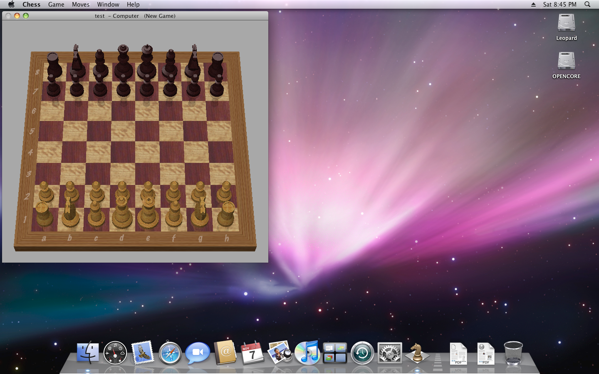
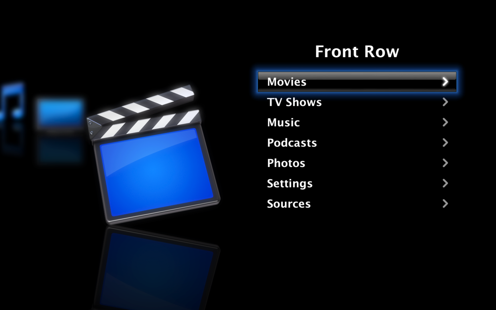
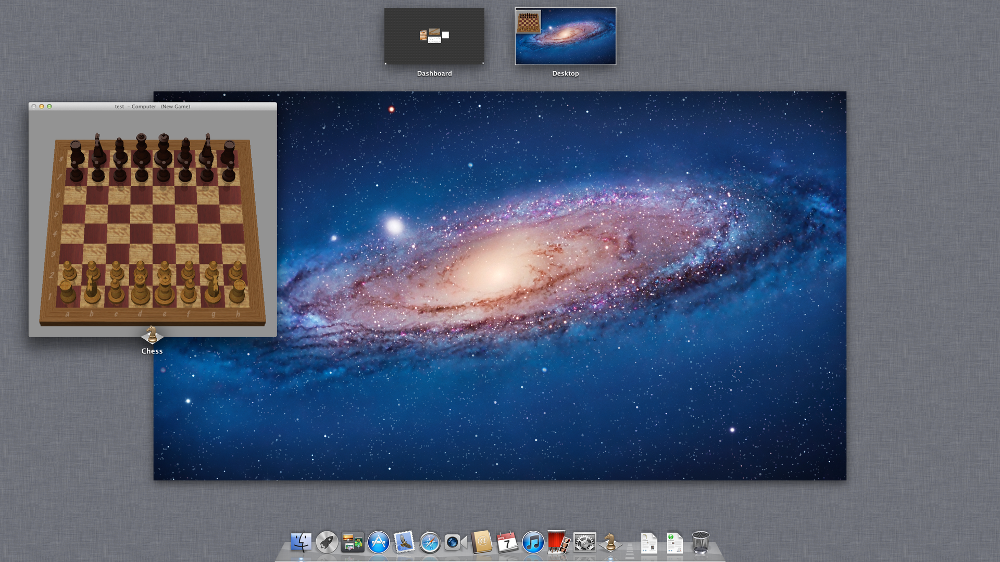
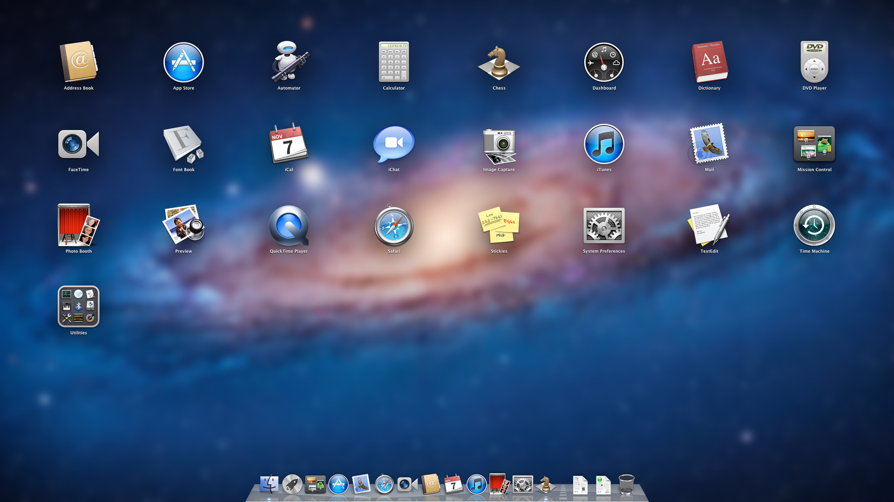

# rv530-qemu: Mac OS X Snow Leopard (and more) with GPU acceleration in QEMU

Run Mac OS X 10.6 (Snow Leopard) in a QEMU virtual machine with
**Quartz Extreme and Core Image enabled**. You do not need GPU passthrough.

**[Read the wiki](https://github.com/CustomDrumDestroyer/rv530-qemu/wiki)** for
setup, installation, troubleshooting, and the FAQ.

The main part is `rv530`, a QEMU display device. It emulates an ATI Radeon
X1600 (RV530, R5xx family). The emulation is sufficiently accurate for the
Apple ATI X1000 drivers to bind to it, with 3D acceleration. These drivers are
not changed. You do not install or patch anything in the guest.

The device emulates the command processor, the 2D engine, vertex and fragment
programs, texturing, and scanout. The 3D engine has two implementations. They
use the same decoders:

- A **Vulkan backend**. It does rasterization, fragment programs, texturing,
  blending, and depth/stencil on the host GPU.
- A **CPU reference path**. It has program interpreters and a software
  rasterizer. It does the draws that the Vulkan backend cannot do.

The repository also has the other parts that a Snow Leopard VM needs:

- A firmware graphics driver for the card.
- An OVMF build script.
- An OpenCore boot-volume builder. It adds the device properties that the
  Apple driver expects.
- A launcher.
- An optional guest agent for drag and drop, clipboard sync, and resizing of
  the guest when you resize the window.

## Host support

| Host | Guest runs under | Graphics | Status |
| --- | --- | --- | --- |
| x86_64 Linux | KVM | Vulkan on the host GPU | Reference host: fastest and most stable |
| Intel Mac | Hypervisor.framework | Vulkan on MoltenVK | Newer, less tested |
| Apple silicon Mac | TCG (emulated CPU, several times slower) | Vulkan on MoltenVK | Least stable |
| x86_64 Windows 10 or 11 | TCG (emulated CPU, several times slower) | Vulkan on the host GPU, or the CPU path | Experimental ([Windows hosts](#windows-hosts)) |

## What works

In a Mac OS X 10.6.8 guest:

- **Desktop:** Quartz Extreme (translucency, shadows, Exposé, Dashboard, Cover
  Flow, Front Row) at up to 2560x1600.
- **Graphics apps:** OpenGL (Chess, Grapher, screen savers), Core Image
  filters, Quartz Composer, and QuickTime video.
- **Host integration:** sound. With the optional guest agent, also drag and
  drop, clipboard sync, and resizing of the guest when you resize the window.
- **Linux guests:** the in-kernel `radeon` driver (KMS, fbcon, X with EXA and
  3D compositing).
- **Mac OS X 10.7.5 (Lion):** installs and runs with Quartz Extreme and Core
  Image (Mission Control, Launchpad). See
  [snowleopard/README.md](snowleopard/README.md#mac-os-x-107-lion).
- **Mac OS X 10.5 (Leopard):** installs and runs with Quartz Extreme and Core
  Image. It uses the 32-bit kernel. See
  [snowleopard/README.md](snowleopard/README.md#mac-os-x-105-leopard).

**Experimental:** a second device, `radeon-hd5770`, emulates an ATI Radeon
HD 5770 (Evergreen). Mac OS X 10.6 and 10.7 run on it with Quartz Extreme and
Core Image. The vertex and pixel shaders run on the host GPU. It uses its own
synthetic AtomBIOS, so you do not need a VBIOS dump. See
[docs/EVERGREEN.md](docs/EVERGREEN.md).

The [Issues](https://github.com/CustomDrumDestroyer/rv530-qemu/issues) page
lists the known bugs. [We welcome contributions](#contributing).

## Status

This project is a **proof of concept and a work in progress**.

- [docs/STATUS.md](docs/STATUS.md) gives the status of each module and the
  known gaps.
- [docs/DESIGN.md](docs/DESIGN.md) gives the original design.

We made this project with AI tools and provide it "as is," without warranty.
See [Disclaimer](#disclaimer).


The Mac OS X 10.6.7 desktop on the emulated X1600. Quartz Extreme composites
the desktop. The emulated GPU draws the translucent menu bar and the reflective
3D Dock.

## Quick start

1. Get QEMU with the device. Use one of these two methods:
   - Download a pre-built package for x86_64 Linux, an Apple silicon Mac, or
     an Intel Mac from the [Releases](../../releases) page. See "Pre-built
     packages" below.
   - Build QEMU with the device yourself: `scripts/setup-qemu.sh`. See
     "Building" below.
2. Follow [snowleopard/README.md](snowleopard/README.md):
   1. Build OVMF. A package already contains OVMF.
   2. Build the OpenCore boot volume.
   3. Install Mac OS X from your own install media, with your own SMC key.
   4. Start Mac OS X with `DISPLAY_MODE=rv530`.

This repository does not contain Apple software, Apple keys, or VBIOS images.
You do not need them from this repository.

## What is here

| Path | Contents |
| --- | --- |
| `qemu/hw/display/rv530/` | The device model: a directory that you add to QEMU 11.1.3 |
| `qemu/patches/0001-build-glue-rv530.patch` | Build glue (meson, Kconfig). Builds the Vulkan backend if the build finds the `vulkan` and `shaderc` pkg-config packages. If not, builds only the CPU path |
| `qemu/patches/0002-ui-input-last-abs.patch` | Lets a display device read the last absolute pointer position. The device uses it to find the cursor hot spot |
| `qemu/patches/0003-ui-gtk-dnd.patch` | GTK UI: drag and drop of files to and from the guest agent |
| `qemu/patches/0004-ui-gtk-resize-toggle.patch` | GTK UI: **View → Resize Guest with Window** for devices that have a run-time `auto-resize` property |
| `qemu/patches/0005-tcg-tsc-macos.patch` | TCG on Apple silicon: a host tick source in nanoseconds, and a TSC that `tsc-frequency` scales |
| `qemu/patches/0006-ui-cocoa-rv530.patch` | Cocoa UI (macOS hosts): drag and drop with the guest agent, View → Resize Guest with Window, and window size in points |
| `qemu/patches/0007-rv530-metal-check-macos.patch` | macOS hosts: builds `r5xx_vk_mac.m`, which checks the Metal devices before QEMU loads MoltenVK |
| `qemu/patches/0008-hvf-log-clear-page-align.patch` | Hypervisor.framework (Intel Macs): aligns to pages the dirty-log clear that std VGA makes unaligned. QEMU 11.1.2 stopped on an assertion without it |
| `qemu/patches/0009-tcg-notdirty-race.patch` | TCG: reads the dirty bits while it holds the TLB lock. It does this when it installs a TLB entry and when it removes `TLB_NOTDIRTY` from an entry. Thus a dirty-log reset at the same time cannot let a vCPU write a page without a log entry |
| `qemu/hw/display/evergreen/`, `qemu/patches/0010-build-glue-evergreen.patch` | The experimental Radeon HD 5770 device and its build glue ([docs/EVERGREEN.md](docs/EVERGREEN.md)) |
| `snowleopard/` | All the parts for the Snow Leopard guest: launcher (with `host.sh`, which selects KVM, Hypervisor.framework, or TCG), install-image tool, OVMF build with the GOP driver of the card, OpenCore boot-volume builder, tablet kext, guest agent, QMP control tool, and in-guest tests ([snowleopard/README.md](snowleopard/README.md)) |
| `scripts/package/`, `.github/workflows/release.yml` | Build the pre-built packages on GitHub Actions |
| `scripts/setup-qemu.sh` | Gets QEMU 11.1.3, adds the device, applies the patches, and builds QEMU and the option ROM |
| `scripts/atombios/mkrom.py`, `scripts/atombios/mkrom-evergreen.py` | Build the synthetic, clean-room AtomBIOS option ROMs of the RV530 and of the HD 5770 |
| `scripts/dnd/`, `scripts/agent-update.sh` | The host side of drag and drop and clipboard sync. Installs the guest agent through ssh |
| `scripts/atomdis.py`, `scripts/regnames.py` | A disassembler for AtomBIOS command tables, with register names (a tool for debugging) |
| `scripts/fetch-references.sh` | Gets the public reference sources that we used to write the code (Linux `radeon` driver files, Mesa 24.0.9) |
| `qemu/hw/display/rv530/tests/` | Unit tests: vertex programs (`pvs/`), fragment programs (`us/`), rasterizer (`raster/`), texture formats and sampling (`tex/`), and tests that compare Vulkan with the CPU path (`vk/`) |
| `qemu/hw/display/rv530/tools/mesa-rc/` | Puts the Mesa r300/r500 shader compiler in a command-line tool. We use it as the reference for the shader decoders |
| `docs/` | Design document, status, the HD 5770 device, and screenshots |

## Pre-built packages

GitHub Actions builds the packages for each [release](../../releases)
(`.github/workflows/release.yml`):

| Package | Host |
| --- | --- |
| `rv530-qemu-*-linux-x86_64.tar.gz` | x86_64 Linux with glibc 2.35 or later (Ubuntu 22.04, Debian 12, Fedora, Arch, and similar), with GTK 3 and a Vulkan driver |
| `rv530-qemu-*-macos-arm64.tar.gz` | Apple silicon Macs |
| `rv530-qemu-*-macos-x86_64.tar.gz` | Intel Macs |
| `rv530-qemu-*-windows-x86_64.zip` | x86_64 Windows 10 and 11 (experimental). The scripts need MSYS2 ([Windows hosts](#windows-hosts)) |

A package contains these items:

- QEMU with the device in `bin/`, and the libraries that QEMU needs in `lib/`.
  On macOS, `lib/` also contains MoltenVK. On Windows, the DLLs are in `bin/`.
- OVMF with the firmware driver of the card, in `firmware/`.
- The option ROMs, in `build-rom/`.
- The scripts and documentation of this repository.

`snowleopard/sl-vm.sh` finds these items in the package. Thus you do not need
to build anything. `THIRD-PARTY-NOTICES.md` lists the bundled libraries and
their licenses.

The macOS packages are not notarized. After you unpack a macOS package, run
`xattr -dr com.apple.quarantine rv530-qemu-*-macos-*` one time. Then
Gatekeeper lets it run.

To make a release, push a tag with the date: `vYYYY.MM.DD`, for example
`v2026.11.02`. For a second release on the same day, add a suffix such as
`.1`. You can also start the workflow manually (Actions > Release > Run
workflow). A manual run builds the packages only as artifacts.

## Building

Hosts: Linux x86_64 with KVM (the reference host), a Mac, or Windows. For a
Mac or Windows, see "macOS hosts" or "Windows hosts" below.

On Linux, you need these items:

- gcc, ninja, meson, python3, and pkg-config.
- The development packages for glib, pixman, GTK 3, and libslirp.
- For the Vulkan backend: `libvulkan-dev` and `libshaderc-dev`.
- For the Vulkan backend: a Vulkan 1.3 GPU with `VK_EXT_external_memory_host`
  and fragment shader interlock. If the GPU has 64-bit floats, the backend
  uses them.

We developed the project on NVIDIA hardware. The Mesa software Vulkan driver,
lavapipe (`mesa-vulkan-drivers`), also has these features. It passes the
Vulkan tests below, which is useful on hosts without a GPU. But it is much too
slow for a desktop guest.

On Ubuntu 24.04:

```
sudo apt install build-essential ninja-build meson python3 pkg-config libglib2.0-dev \
    libpixman-1-dev libgtk-3-dev libslirp-dev libpng-dev zlib1g-dev curl xz-utils \
    libvulkan-dev libshaderc-dev glslang-tools
scripts/setup-qemu.sh
```

This command makes `build-qemu/qemu-11.1.3/build/qemu-system-x86_64` and the
option ROM `build-rom/rv530-atombios.rom`.

### macOS hosts

On an Intel Mac, the guest runs under Hypervisor.framework, similar to KVM.

Apple silicon has no hardware virtualization for x86 guests. Thus the guest
runs under multi-threaded TCG, which is several times slower.

On both types of Mac, MoltenVK sends the fragment work to the GPU of the Mac.
`snowleopard/host.sh` selects the accelerator. `sl-vm.sh` and
`make-opencore.sh` use the accelerator that `host.sh` selects.

Apple silicon, with Homebrew:

```
brew install ninja meson pkg-config glib pixman libslirp libpng sdl2 python@3.13 \
    molten-vk vulkan-loader vulkan-headers shaderc glslang \
    nasm acpica mtools dosfstools x86_64-elf-gcc x86_64-elf-binutils
scripts/setup-qemu.sh
```

Intel Mac, with MacPorts. The Homebrew installer does not run on Intel Macs
now.

```
sudo port install ninja meson pkgconfig glib2 libpixman libslirp libpng libsdl2 python313 \
    MoltenVK vulkan-loader vulkan-headers shaderc glslang \
    nasm acpica mtools dosfstools x86_64-elf-gcc x86_64-elf-binutils
scripts/setup-qemu.sh
```

Then follow [snowleopard/README.md](snowleopard/README.md), as on Linux, with
these changes:

- Use `QDISPLAY=cocoa` to get a window.
- Use `snowleopard/make-installer.py` to make the installer disk from an
  install `.dmg`.

The Cocoa window has the same drag and drop, clipboard sync, and View → Resize
Guest with Window as the GTK window.

The scripts do these tasks on a Mac:

- **Under TCG (Apple silicon):**
  - They set an explicit core topology.
  - They set a 1.2 GHz TSC (`qemu/patches/0005`). At 1 GHz, 10.6 panics when
    it builds its commpage.
  - They give the guest 2 GB of memory by default.
  - They add two OpenCore kernel patches. These patches remove the time
    limits from the spinlock and TLB-shootdown waits of 10.6, because an
    emulated vCPU can stop for some seconds.
  - They set the lock timeout (`slto_us`) to 2 s. 10.6 keeps this value in
    nanoseconds in a signed `int`. Above approximately 2.1 s, the value
    becomes negative. Then 10.6 panics with "clear_wait_internal: deadlock"
    at the first wait-queue lock that two vCPUs both try to get.
- **Under Hypervisor.framework (Intel):**
  - They use the KVM CPU model without the options that only KVM has.
  - They use `qemu/patches/0008`. Without it, QEMU stops on an assertion when
    the kernel of 10.6 starts to control the std VGA display.
- **MoltenVK:**
  - Mac GPUs have no 64-bit floats. Thus the device calculates depth exactly
    with 32-bit floats.
  - MoltenVK can call `abort()` while it examines a Metal device that is not
    in `MTLGPUFamilyMac2`. An example is the paravirtualized GPU of a macOS
    virtual machine. Thus the device checks the Metal devices first. If no
    device is satisfactory, the device uses the CPU path and shows a warning.

Tests:

- We tested on an Apple silicon Mac.
- We tested Intel in an x86_64 macOS 15 virtual machine with nested VT-x.
- In both tests, `CGDisplayUsesOpenGLAcceleration` is 1. The Core Image blur
  check gives exactly the same result as the software renderer.
- The Intel test ran the 3D engine on the CPU path, because the Metal device
  of that virtual machine cannot run MoltenVK. We did not test the Vulkan
  backend on the GPU of an Intel Mac.

### Windows hosts

Windows support is experimental. QEMU and the scripts run in the UCRT64
environment of [MSYS2](https://www.msys2.org/). The guest runs under
multi-threaded TCG, with the same settings as on Apple silicon.

Install MSYS2. Then, in the "MSYS2 UCRT64" shell:

```
pacman -S --needed git make diffutils patch tar xz curl dosfstools \
    mingw-w64-ucrt-x86_64-{toolchain,meson,ninja,python,pkgconf,glib2,pixman,gtk3,SDL2} \
    mingw-w64-ucrt-x86_64-{libslirp,libpng,vulkan-loader,vulkan-headers,shaderc,glslang,mtools}
scripts/setup-qemu.sh
```

With a release package, you need only `python`, `dosfstools`, and `mtools`
from this list. Then follow [snowleopard/README.md](snowleopard/README.md),
with these changes:

- Use `QDISPLAY=gtk` or `QDISPLAY=sdl` to get a window.
- QMP uses TCP: `sl-vm.sh` listens on `127.0.0.1:4444`, and `slctl.py` takes
  `QMP=127.0.0.1:4444`. Python on Windows cannot use Unix sockets.
- `AUDIO=usb` uses DirectSound.
- `CLIPBOARD` and `DND` do not work yet.
- `SYSDISK` can be a disk image or a physical disk, for example
  `SYSDISK='\\.\PhysicalDrive1' SYSDISK_FORMAT=raw`. A physical disk needs
  an administrator shell.

Tests:

- We tested in a Windows 10 LTSC 2021 virtual machine (KVM, 4 vCPUs, 4 GB),
  with Mac OS X 10.6.8 under TCG inside it.
- With the CPU path (`RVOPTS=vulkan=off`), the desktop has Quartz Extreme, and
  `gltest` and `gltex` give the correct results.
- That virtual machine has no GPU. With the Mesa software Vulkan driver
  (lavapipe), the Vulkan tests (`tests/vk`) pass, and the desktop draws
  correctly. But GL programs in the guest read back only black. We did not
  test the Vulkan backend on a real GPU under Windows.
- Windows Hypervisor Platform (`ACCEL=whpx`) did not start in that virtual
  machine (nested Hyper-V under KVM). We did not test it on a real computer.

## The option ROM

The card needs an AtomBIOS option ROM. Drivers use it to find the connectors
and to set the display timings. Real VBIOS images are copyrighted and are
**not** part of this repository.

Instead, `scripts/atombios/mkrom.py` builds a synthetic ROM from the public
`atombios.h` layouts. `scripts/atombios/mkrom-evergreen.py` does the same for
the HD 5770 ([docs/EVERGREEN.md](docs/EVERGREEN.md#the-option-rom)). The ROM of
the RV530 has these parts:

- A FirmwareInfo table.
- One DVI-I connector on DDC1.
- "Paravirtual" command tables. Each table gives its parameters to the device
  through a mailbox register block. The device then does the operation in C
  (`r5xx_atom.c`).

You do not need a VBIOS dump.

## Running

Minimum device options on a q35 machine, for a Linux guest:

```
qemu-system-x86_64 -M q35 -accel kvm -m 4G -vga none \
    -device pcie-root-port,id=rp1,chassis=1,slot=1 \
    -device rv530,bus=rp1,romfile=build-rom/rv530-atombios.rom \
    -display gtk ...
```

- **Mac OS X 10.6:** use `snowleopard/sl-vm.sh`. It sets all the other items
  that the guest needs (see [snowleopard/README.md](snowleopard/README.md)).
  It puts the card behind a conventional `pci-bridge`. The guest does not
  service the interrupt of a PCIe root port that shares the line of the card.
- **Linux guests:** put the card behind a `pcie-root-port`, as the example
  shows. The `radeon` driver uses the PCIe GART only when the card is a PCIe
  endpoint. The card must be the only VGA device. The guest needs the R520 CP
  microcode, `radeon/R520_cp.bin`, from the linux-firmware package.

### Device properties

| Property | Meaning |
| --- | --- |
| `romfile` | The option ROM (see above) |
| `vram_size_mb` | VRAM size, 32 to 256 (default 256) |
| `device-id`, `subsys-vendor-id`, `subsys-id`, `revision` | PCI identity (default 1002:71C5, subsystem 106B:0080) |
| `xres`, `yres` | The preferred mode in the EDID, and the mode that the device sets at reset |
| `xmax`, `ymax` | The largest mode that the EDID shows (default 2560x1600, CVT reduced blanking) |
| `refresh` | Refresh rate of the preferred mode, in Hz (default 60) |
| `resize` | At start, the guest resolution follows the window. While the VM runs, the run-time `auto-resize` property (`qom-set`) and the GTK View menu change this setting |
| `vulkan` | The host-GPU backend (default on). If no applicable device is available, the device uses the CPU path and shows a warning |
| `vk-verify` | Also runs GPU draws on the CPU path and traces the differences (a tool for debugging, slow) |
| `cp-sync` | Runs the command processor synchronously on ring writes (default on) |
| `clipboard` | The chardev ID for text clipboard sync with the guest agent (`snowleopard/agent`) |
| `debug` | Bit 0 logs each unknown register one time, bit 2 logs PM4 packets, and bit 3 logs 3D state |

### Environment variables

| Variable | Meaning |
| --- | --- |
| `RV530_VK_DEVICE` | Selects a Vulkan device by index |
| `RV530_VK_CACHE_DIR` | Persistent shader cache (default `~/.cache/rv530`) |
| `RV530_VK_STATS` | Prints the GPU/CPU split of the draws every 2 s |
| `RV530_VK_TRACE` | Logs each Vulkan batch with its timing |
| `RV530_VK_SYNC_COMPILE`, `RV530_VK_NO_MIRROR`, `RV530_VK_FLUSH_EACH`, `RV530_VK_NO_SYSRAM` | Debugging switches for the Vulkan backend. With `RV530_VK_NO_SYSRAM`, the CPU path does the textures and render targets that are in system memory |
| `RV530_VK_CHECK_MIRROR` | `1` or `2`: compares the device-local VRAM mirror with host VRAM. Reports pages that the guest changed without a dirty-log entry, and bytes that the write-back changed back |
| `RV530_VK_WB_COPY`, `RV530_VK_WB_STATS` | Write-back: copy full row bands back from the mirror, as before the merged write-back. Or report the bytes that the write-back kept |
| `RV530_NO_UNLOCK` | The device never releases the global lock of QEMU while it waits (a debugging switch) |
| `RV530_CPU_THREADS` | The number of workers for the CPU rasterizer |
| `RV530_STALL_MS` | Reports device work that holds the global lock of QEMU for more than this time (default 100), with the time for each phase |
| `RV530_DUMP_DIR` | Directory for a dump of each draw (with the `rv530_dump` trace event) |

### Tracing

`-trace 'rv530_*'` logs these items, and more:

- MMIO accesses, with register names.
- PM4 packets.
- GART programming.
- Changes of the scanout mode.
- Draws that go to the CPU path (`rv530_vk_fallback`), with the reason.

`-d guest_errors,unimp` lists GPU address faults and registers that the device
does not handle. It lists each one only one time.

## Tests

```
make -C qemu/hw/display/rv530/tests/pvs check
make -C qemu/hw/display/rv530/tests/us check
make -C qemu/hw/display/rv530/tests/raster check
make -C qemu/hw/display/rv530/tests/tex check
make -C qemu/hw/display/rv530/tests/vk && RV530_VK_SYNC_COMPILE=1 qemu/hw/display/rv530/tests/vk/test_vk
```

Some test steps use the reference sources from `scripts/fetch-references.sh`.
On macOS, build the tests with `CC=clang`. If no Metal device can run
MoltenVK, `tests/vk` does not run its tests and shows the reason.

## Screenshots

All screenshots come from the emulated Radeon X1600 on the Vulkan backend.
Each subsection names the guest. [docs/EVERGREEN.md](docs/EVERGREEN.md) has
screenshots of the experimental Radeon HD 5770.

### Linux


Linux `radeon` KMS with fbcon.


X with the EXA acceleration of the radeon driver.

### Mac OS X 10.6.8 (Snow Leopard)


Chess: 3D pieces with lighting and depth test, from the fixed-function vertex
programs of Apple.


The Toroid example of Grapher at 2560 x 1600: a parametric surface with
lighting and depth test.


Quartz Composer plays the Arabesque composition (Core Image feedback and blur)
at approximately 20 frames per second.


The Flurry screen saver (OpenGL, full screen).


The full-screen menu of Front Row.


QuickTime Player X plays the sample movie from Apple. Core Video shows the
frames through OpenGL as Y'CbCr textures.

### Mac OS X 10.5.0 (Leopard)



Chess on Mac OS X 10.5.0 at 1440 x 900, with the translucent menu bar and
the 3D Dock of Leopard.


The Arabesque screen saver on Mac OS X 10.5.0. It is a Quartz Composer
composition with Core Image feedback and blur, in full screen.



The full-screen menu of Front Row on Mac OS X 10.5.0.

### Mac OS X 10.7.5 (Lion)



Mission Control on Mac OS X 10.7.5, with Chess open. The guest runs at
2560 x 1440.



Launchpad on Mac OS X 10.7.5. Core Image blurs the desktop behind the icons.
The guest runs at 2560 x 1440.

## Contributing

We welcome contributions. Fork the repository and open a pull request. We
especially want help with these items:

1. **Better support for macOS and Apple silicon hosts**
2. **Support for Windows hosts**, which does not exist now

[CONTRIBUTING.md](CONTRIBUTING.md) tells you where to start on these two items,
how to report bugs, and how to send changes.

## Licensing

The device model, patches, and scripts are licensed under the GNU General
Public License, version 2 or (at your option) any later version. QEMU is
licensed under the same terms (see `COPYING`). The sources credit the Linux
kernel (GPL) and Mesa (MIT) for the register definitions taken from them.

`make-opencore.sh` downloads OpenCore (BSD license) from its official release
page and checks its SHA-256. `build-ovmf.sh` gets edk2 (BSD-2-Clause-Patent).
This repository does not redistribute either of them.

This repository does not contain these items. Do not add them:

- VBIOS images of real cards.
- CP microcode.
- Operating system install media or disk images.
- The Apple SMC key.
- Apple software of any type.

Apple's license for Mac OS X 10.6 permits running it in a virtual machine
only for Mac OS X Server. You are responsible for having a license that covers
your use.

ATI and Radeon are trademarks of Advanced Micro Devices. Mac OS X, Quartz, and
Core Image are trademarks of Apple. This project is not affiliated with either
company.

## Disclaimer

We made this project, its code, and its documentation with help from AI
tools. We tested it as the commit messages describe, but it can still contain
errors.

We provide it **"as is,"** without warranty of any kind, express or implied,
including the warranties of merchantability and fitness for a particular
purpose. Sections 11 and 12 of the GNU General Public License, version 2, say
the same. You use it at your own risk. The authors are not liable for any
damage or data loss that results from its use, including damage to virtual
machines, disk images, and host systems.
