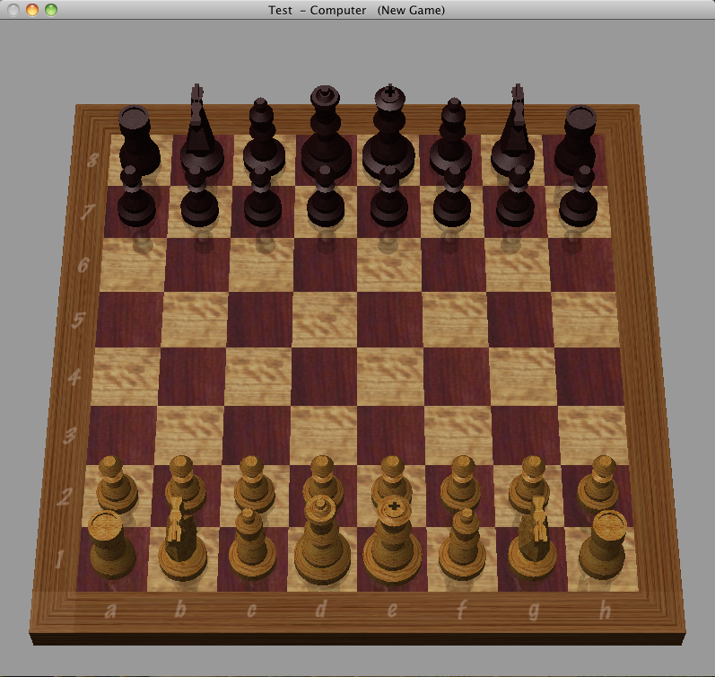
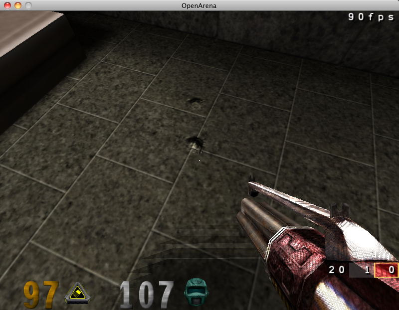
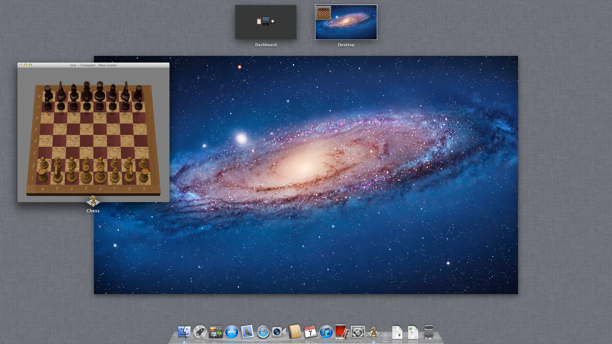

# The Radeon HD 5770 device (experimental)

`radeon-hd5770` is a second display device. It emulates an ATI Radeon HD 5770
(Juniper, Evergreen family). Mac OS X 10.6, 10.7, and 10.9 run on it with the
drivers from Apple (`ATIRadeonX3000`, in 10.9 `AMDRadeonX3000`, framebuffer
`Hoolock`). These drivers are not changed.
Quartz Extreme and Core Image are enabled. The pixel work runs on the host GPU
through Vulkan.

This device is **experimental**. The RV530 (Radeon X1600) is the main device of
this repository. Use the HD 5770 to test, not for daily use.



Chess on the emulated HD 5770: lit 3D pieces, reflections, and wood textures.



OpenArena at 800 x 600 on the emulated HD 5770. This view runs at 90 frames
per second, and busier views at approximately 22.

## What you supply

- A Snow Leopard or Lion disk, as for the RV530
  ([snowleopard/README.md](../snowleopard/README.md)).

You do not need a VBIOS dump. The device uses a synthetic AtomBIOS (see
[The option ROM](#the-option-rom)).

## Setup

1. Build QEMU with `scripts/setup-qemu.sh`. Patch
   `qemu/patches/0010-build-glue-evergreen.patch` adds the device. The Vulkan
   backend needs the `vulkan` and `shaderc` pkg-config packages, as for the
   RV530.
2. Build a second boot volume with the framebuffer name and the model of the
   card. Keep the boot volume of the X1600 for the RV530. The zip is the
   OpenCore download that `make-opencore.sh` keeps in `work/`:

   ```
   cd snowleopard
   SL_FBNAME=Hoolock SL_GPUMODEL="ATI Radeon HD 5770" \
       ./make-opencore.sh work/OpenCore-1.0.8-DEBUG.zip work/esp-hd5770
   ```

3. Start the VM with that boot volume:

   ```
   DISPLAY_MODE=hd5770 ESP=$PWD/work/esp-hd5770 ./sl-vm.sh
   ```

   `EGOPTS` adds device properties, for example `EGOPTS=vulkan=off`.

System Profiler → Graphics/Displays shows an ATI Radeon HD 5770 with 1024 MB.

## Device properties

| Property | Default | What it does |
| --- | --- | --- |
| `romfile` | (none) | The option ROM. The launcher gives `build-rom/hd5770-atombios.rom` |
| `vram_size_mb` | 1024 | VRAM size. BAR0 is a 256 MB window into it |
| `xres`, `yres` | 1440, 900 | The preferred mode of the EDID |
| `vulkan` | on | Off: the CPU does all the 3D work (slow, but a reference) |
| `debug` | 1 | Bit mask for logs: 1 unknown registers, 2 ignored packets, 4 each draw, 8 draw state, 16 each PM4 packet, 32 HDP |

## What works

We tested these items on an x86_64 Linux host with KVM and an NVIDIA GPU:

| Item | Result |
| --- | --- |
| Quartz Extreme | `CGDisplayUsesOpenGLAcceleration` is 1 |
| Core Image | `snowleopard/tests/ci_blur_check.py`: max diff 0 |
| Desktop | Translucent menu bar, 3D Dock, window shadows |
| Exposé, Dashboard, Front Row | Work |
| Chess | Works (see the screenshot) |
| QuickTime Player X | Plays the sample movies (Y'CbCr textures) |
| `gltest`, `glms` | Clear color and triangle correct |
| `gltex`, `gltexfmt`, `glvbo` | All cases correct |
| `glstrip` | Solid cylinder on the plane (depth test, culling) |
| `gltexyuv` | The two correct byte orders give `ff8400`, the BT.601 value of the test bytes |
| OpenArena 0.8.8 | 22-90 frames per second in play at 800 x 600, by view |
| Nexuiz `bench1` demo | 28 frames per second at 1280 x 720, 4 vCPUs (see [Performance](#performance)) |

## Mac OS X 10.7 Lion

Lion (10.7.5) runs on the HD 5770 with the drivers of Lion (`ATI-7.32.12`).
Quartz Extreme and Core Image are enabled. Make the Lion disk as
[snowleopard/README.md](../snowleopard/README.md#mac-os-x-107-lion) tells.
Then make a boot volume with the identity of the HD 5770 and the settings
of Lion. Use the `SystemUUID` of the Lion boot volume:

```
cd snowleopard
SL_FBNAME=Hoolock SL_GPUMODEL="ATI Radeon HD 5770" SL_KCACHE=Auto SL_UUID=<uuid> \
    ./make-opencore.sh work/OpenCore-1.0.8-DEBUG.zip work/lion-eg/esp
```

To keep the RV530 Lion disk as it is, start from an overlay disk:

```
qemu-img create -f qcow2 -b $PWD/work/lion/lion.qcow2 -F qcow2 work/lion-eg/lion-eg.qcow2
WORK=$PWD/work/lion-eg SYSDISK=$PWD/work/lion-eg/lion-eg.qcow2 ESP=$PWD/work/lion-eg/esp \
    DISPLAY_MODE=hd5770 SSHPORT=2228 SMP=4 MEM=4096 ./sl-vm.sh
```

We tested these items in Lion:

| Item | Result |
| --- | --- |
| Login window, desktop, menu bar, Dock | Correct at 2560 x 1440 |
| Mission Control, Launchpad, Dashboard | Correct (see the screenshot) |
| Chess | Correct |
| `gltest`, `glms`, `gltex`, `gltexfmt`, `glstrip`, `gltexyuv` | The same results as in 10.6 |
| Core Image | `ci_blur_check.py`: max diff 0. `ci_blur_bench.py`: approximately 16 ms per frame |
| Nexuiz `bench1` demo | 28.1 frames per second at 1280 x 720, 4 vCPUs |

The first start of a program in Lion compiles its pipelines. During that
time, the frame rate is lower.



Mission Control in Lion on the emulated HD 5770, with Chess open.

## OS X 10.9 Mavericks

Mavericks (10.9, 13A603) runs on the HD 5770 with its own AMD drivers
(`AMD5000Controller`, `AMDRadeonX3000`). Make the boot volume as for Lion,
with the `SystemUUID` of the Mavericks volume. The boot volume must have a
complete kernel cache. Without it, the `boot.efi` of 10.9 stops with no
message.

In 10.9, Core Image uses OpenCL. OpenCL sends its kernels to the GPU as
compute dispatches (see [Compute](#compute)).

We tested these items in Mavericks:

| Item | Result |
| --- | --- |
| Login window, desktop, menu bar, Dock | Correct at 1440 x 900 |
| Mission Control | Correct |
| Chess | Correct |
| `gltest`, `glms`, `gltex`, `gltexfmt`, `glstrip`, `gltexyuv` | The same results as in 10.6 |
| Core Image | `ci_blur_check.py`: max diff 0. `ci_blur_bench.py`: 10-13 ms per frame, 4 vCPUs |

## The option ROM

Real VBIOS images are copyrighted and are not part of this repository.
`scripts/atombios/mkrom-evergreen.py` builds a synthetic AtomBIOS for the
device. `scripts/setup-qemu.sh` writes it to `build-rom/hd5770-atombios.rom`,
and the launcher makes it if it is not there. The script uses the public
layouts of `atombios.h`, `ObjectID.h`, and `pptable.h` (Linux `radeon`). It
copies no bytes from a real ROM.

The ROM has these parts:

- The identity strings in the layout of AMD option ROMs. The number of strings
  is at 0x2f, a pointer to the first string is at 0x6e, and the date is at
  0x50. The Apple driver rejects a ROM without them.
- A master command table with 80 entries. The Apple driver rejects a longer
  table.
- FirmwareInfo 2.1: the clocks and the 27 MHz reference clock.
- GPIO_I2C_Info and GPIO_Pin_LUT: the eight DDC pairs and the six HPD pins of
  the device model.
- Object_Header 1.3: two DisplayPort connectors and one dual-link DVI-I
  connector, with their encoders, DDC lines, and HPD pins. This is the board
  wiring of the Mac Pro HD 5770, which the Hoolock framebuffer expects. We
  took these facts from the connector table of the real card. We did not copy
  the table.
- PowerPlayInfo: a boot state and a performance state. Without this table,
  the Apple driver reads other bytes as the table, and the kernel panics.
- Paravirtual command tables, as in the ROM of the RV530. Each table gives its
  parameters to the device through a mailbox register block, and the device
  does the operation in C (`eg_atom.c`).

The Apple driver programs most display registers itself. Thus most command
tables do nothing in the device. `EnableCRTC` sets the master enable bit of
the CRTC. Without it, there is no scanout and no vertical blank interrupt, and
GL programs draw only black. The clock queries, `AdjustDisplayPll`,
`ComputeMemoryEnginePLL`, `PowerConnectorDetection`, and the DisplayPort
tables return values. The trace event `eg_atom_call` logs each call.

A real VBIOS still works: set `ROM5770` to the file. Remove its EFI driver
first with `scripts/vbios-x86only.py`, because OVMF cannot run that driver.

## How the device works

The files are in `qemu/hw/display/evergreen/`.

| File | Contents |
| --- | --- |
| `evergreen.c` | PCI device (1002:68B8, subsystem 106B:00CF), BARs, register file, interrupts, and the GART (VM context 0, 64-bit PTEs) |
| `eg_cp.c` | Ring and indirect buffers, PM4 packets, scratch and RPTR write-back, and the async DMA engine |
| `eg_dce.c` | DCE4 scanout (linear), the hardware cursor, interrupts, and the DDC bus with the EDID of the RV530 device |
| `eg_hdp.c` | HDP apertures that the driver uses to copy surfaces |
| `eg_atom.c` | The mailbox behind the paravirtual command tables of the synthetic AtomBIOS |
| `eg_draw.c` | 3D state, draws, vertex fetch, the vertex shader on the CPU, clipping, and the CPU rasterizer. It sends each draw to the Vulkan backend |
| `eg_shader.c` | Interpreter for the Evergreen shader ISA (VS, PS, and fetch shaders) |
| `eg_tex.c`, `eg_tile.c` | Texture formats, sampling, and the 1D/2D tiling of Evergreen |
| `eg_vk.c`, `eg_vk_ps.c`, `eg_vk_frag.glsl` | Vulkan backend. `eg_vk_ps.c` translates the pixel shader and the vertex shader (with its fetch shader) to GLSL. The fragment shader also does the CB/DB back end (formats, tiling, blending, depth and stencil) on VRAM, with fragment-shader interlock |

For triangle draws, the host GPU also runs the vertex shader, the window
transform, clipping, and culling. The CPU only turns the indices into
triangles. Rect lists, lines, and points use the vertex shader on the CPU.
The backend imports the guest RAM (for GART surfaces) as a Vulkan buffer, and
keeps a copy of the VRAM in device-local memory. Pages that the CPU or the
guest writes go up to that copy before the draws that use them. The rows that
a batch can change go back to the guest VRAM at the end of the batch.

The vCPU that writes the ring pointer does not wait for the CP or the GPU.
The CP runs the ring in a bottom half of the main loop:

- A ring kick starts its draws on the GPU and goes on. Two frames of command
  buffers let the GPU run one batch while the next one records.
- Fences (`EVENT_WRITE_EOP`, `MEM_WRITE`, scratch write-back, the ring
  interrupt) wait in a queue. The device writes each fence when the GPU has
  completed the batch before it, so the guest sees it only after the
  rendering.
- The interrupt of an `EVENT_WRITE_EOP` fence goes out if `CP_INT_CNTL`
  enables timestamp interrupts when the fence completes, as on the hardware.
  Apple's drivers enable them when they start to wait for a timestamp, which
  can be after the CP read the packet. When the device checked the bit at
  the packet, the wait of 10.9 ended only at its 1 s timeout.
- `GRBM_STATUS` shows `GUI_ACTIVE` while batches run. Apple's driver polls it
  to wait for the GPU.
- Each batch marks the VRAM that it drew as dirty when it completes. The
  display does not wait for the GPU.
- The device waits for the GPU only before work that reads the results on the
  CPU. This work is `CP_DMA`, `COPY_DW`, the DMA engine, HDP copies, draws on
  the CPU, and reads of the scratch registers.
- While it waits for a GPU frame or a pipeline compile, the CP releases the
  BQL, as the RV530 does. Other vCPUs then keep running. Until the CP has the
  BQL again, MMIO accesses of other vCPUs wait (`GRBM_STATUS` reads get a busy
  value).
- The register BAR does not use the BQL. A write of the ring pointer only
  stores the pointer and starts the CP. Thus the guest does not wait while the
  CP runs the commands before it. All other register accesses take the BQL.
- A batch goes to the GPU when it has 64 draws, also in the middle of a ring
  kick. Thus the GPU runs one batch while the CP records the next one. Up to
  four batches can wait for the GPU.
- A thread waits for the Vulkan fence of each batch. When a batch completes,
  the device writes its fences at once, also between the packets of a ring
  kick.
- An occlusion query (`ZPASS_DONE`) does not wait for the GPU. The draws count
  their pixels in a slot of the query. The device writes the result when the
  batch completes, in order with the other fences.

The GPU side has these optimizations:

- The CPU writes the state of each draw (21.7 KB) to host memory. When a
  batch starts, one copy moves the states of the batch to device-local
  memory. Thus the shaders do not read the states across PCIe.
- The shader marks each 4 KB page of the VRAM copy that it writes. At the end
  of a batch, a compute pass copies only these pages to the guest VRAM.
- The fragment shader can do the depth test first. The conditions are: the
  depth test is LESS or LEQUAL, stencil is off, and the pixel shader does not
  write the depth. If
  all pixels of a 2 x 2 quad fail, the pixel shader does not run. This test is
  correct only while the stored depth values do not increase. Thus a draw
  that can increase them (for example a clear) causes a barrier before the
  next draw that uses the early test.

For each pixel shader, the backend compiles a generic pipeline and
specialized pipelines. A specialized pipeline has state values as constants.
These are the formats, swizzles, tiling, and sampler words of the textures,
and the formats, blending, and tiling of the color buffers. The host compiler then removes the
branches that the draw does not use. Thus, texture-heavy programs run 2-4 times
faster. Until the specialized pipeline is ready, the draw uses the generic
pipeline.

When the CPU runs the vertex shader, it does 16 vertices at a time. Draws
with 128 new vertices or more shade them on the raster workers in parallel.
GART reads of guest RAM use a cache of host pointers.

The work of the CPU for each draw is small:

- The translation cache key is the dwords that the translation read. Apple's
  driver keeps other data after its programs. A key of the whole program chunk
  made a new translation (and new pipelines) for each change of that data.
- Texture descriptors are cached by their resource words.
- GART table entries stay while their PTE keeps its value.

Apple's GL engine sends its constants with `SET_ALU_CONST` and leaves the
constant buffer address at 0. The device then reads kcache windows from the
constant file of the stage.

### Compute

`DISPATCH_DIRECT` runs a compute shader (`eg_compute.c`). The device uses the
registers and slots that Apple's OpenCL driver uses:

- The program is at `SQ_PGM_START_LS`. The thread groups have
  `SPI_COMPUTE_NUM_THREAD_X/Y/Z` threads.
- Each thread starts with its index in the group in R0.xyz and the index of
  its group in R1.xyz.
- Constants come from the LS constant caches (`SQ_ALU_CONST_CACHE_LS_n`).
  Textures use the fetch resources from 816 and the samplers from 90.
- `MEM_RAT` writes the results. RAT n is `CB_COLORn`. The device writes
  `STORE_TYPED` pixels with the format and tiling of the color buffer, and
  `STORE_RAW` dwords to a linear buffer.

The Vulkan backend runs the dispatch on the host GPU:

- `eg_vk_ps.c` translates the program to the GLSL function `cs_run()`.
  `eg_vk_frag.glsl` with `EVK_CS` makes it a compute shader. Each invocation
  is one guest thread, and `rat_store()` writes the RATs with the same
  tiling and format code as the pixel back end.
- The dispatch goes into the current batch, in order with the draws, with a
  barrier before it and after it. Its RATs go back to the guest VRAM at the
  end of the batch, as render targets do.
- Each program has a generic and a specialized pipeline, as pixel shaders
  have.

The CPU runs the dispatch when the translation or the pipeline is not
available, for example while the pipeline compiles. Before a dispatch on the
CPU, the device waits for the GPU. After it, the device marks the color
buffers as dirty, so the GPU uses the new data. The caller and up to 15
worker threads run batches of 16 threads. The CP releases the BQL during
the dispatch, as it does while it waits for the GPU.

Apple's Core Image kernels in 10.9 use ALU, `SAMPLE`, and `MEM_RAT`
`STORE_TYPED` only. The device does not have local data share (LDS),
barriers, or atomic RAT operations.

## Debugging

| Variable | What it does |
| --- | --- |
| `EG_VK_VERIFY=1` | Runs each GPU draw on the CPU path too, from the same VRAM, and logs the bytes that are different. The CPU result stays. Use `SMP=1`: the extra work can make a guest with more vCPUs panic |
| `EG_VK_SYNC_COMPILE=1` | Compiles each pixel shader before its draw. Use it with `EG_VK_VERIFY`, so that all draws go to the GPU |
| `EG_VK_DUMP_DIR=dir` | Use with `EG_VK_VERIFY`. For each program with a difference, it writes the microcode (`.bin`), the GLSL, the state, the surfaces, and a `.replay` file. The surfaces are from the CPU and the GPU, also as PPM files |
| `EG_PROFILE=1` | Every 2 s, logs the CPU time of each part of a draw, the time spent waiting for the GPU, and which callers waited |
| `EG_VK_STATS=1` | Every 1024 GPU draws, logs the draw, fallback, batch, barrier, and pipeline counts |
| `EG_VK_TRACE=1` | Logs each batch |
| `EG_VK_CACHE_DIR` | The SPIR-V cache (default `~/.cache/rv530/evergreen`. Empty: no cache) |
| `EG_KICK_FLUSH=1` | Waits for the GPU at the end of each ring kick |
| `EG_NO_UNLOCK=1` | Keeps the BQL while the CP waits for the GPU |
| `EG_VK_NO_SPECIALIZE=1` | Uses only the generic pipelines |
| `EG_VK_TIMESTAMPS=1` | With `EG_PROFILE`: also logs the GPU time of the batches and of the copy-back |
| `EG_NO_GPU_VS=1` | Runs all vertex shaders on the CPU |
| `EG_CP_SYNC=1` | Runs the ring in the vCPU that writes the ring pointer |
| `EG_VK_NO_MIRROR=1` | No device-local VRAM copy: the shaders use the guest VRAM directly |
| `EG_VK_BATCH_DRAWS=n` | A batch goes to the GPU when it has n draws (default 64. 0: only at fences and at the end of a ring kick) |
| `EG_VK_IDLE_DRAWS=n` | A batch goes to the GPU when it has n draws and the GPU is idle (default 0: off) |
| `EG_VK_SUBMIT_DRAWS=n` | At the end of a ring kick, the batch goes to the GPU when it has n draws (default 256) |
| `EG_VK_NO_EARLY_Z=1` | No early depth test |
| `EG_VK_NO_WAITER=1` | No completion thread: a timer polls the fences of the batches |
| `EG_VK_DRAWS_HOST=1` | The shaders read the draw states from host memory |
| `EG_MMIO_BQL=1` | All register accesses take the BQL, also the ring pointer |
| `EG_VK_DRAWSTAMPS=1` | Writes a GPU timestamp after each draw, and logs the GPU time of each program |
| `EG_CS_THREADS=n` | Compute dispatches use n worker threads and the caller (default: half the host CPUs, at most 16 threads in all) |
| `EG_CS_CPU=1` | Runs all compute dispatches on the CPU |
| `EG_CS_PROFILE=1` | Logs the size of each compute dispatch, and where it runs (and why on the CPU), or its time on the CPU |
| `EG_CS_DUMP=dir` | Writes the state and the program of the first 64 compute dispatches to `dir` |
| `EG_VK_DEFS=...` | Adds lines to the start of each shader (`;` starts a new line). For experiments. A change compiles all pipelines again |

`qemu/hw/display/evergreen/scripts/eg_vk_replay` runs a `.replay` file through
the backend outside QEMU. Build it with `eg_vk_replay.sh`. Give it the dumped
GLSL (or an edited copy), or the `.bin` to translate the microcode again:

```
eg_vk_replay ps-<hash>.replay ps-<hash>.bin out.bin
cmp out.bin ps-<hash>.s0.cpu
```

`EG_REPLAY_REPEAT=n` draws the dump n times and prints the GPU time.

## Performance

Nexuiz `bench1` at 1280 x 720, on the host of "What works", with a VM of 4
vCPUs and 4 GB. Each line adds to the line before it:

| Change | Frames per second |
| --- | --- |
| Pixel stage on the GPU, fences after the GPU, specialized pipelines, parallel CPU vertex shader | 7.7 |
| Vertex shader on the GPU | 9.2 |
| Ring in a bottom half (the vCPU does not wait for the CP) | 10.1 |
| Device-local VRAM copy, copy-back of the scissor rows only | 11.1 |
| GART entries kept while their PTE stays the same | 11.5 |
| Texture descriptor cache, shorter hazard lists | 14.5 |
| Translation cache keyed by the code that the translation read | 20.4 |
| Copy-back of the written pages only, early depth test, completion thread | 20.3 |
| Draw states in device-local memory | 20.6 |
| Register BAR without the BQL | 22.8 |
| Four batches in flight instead of two | 25.1 |
| Batches of 64 draws, also inside a ring kick | 28.0 |

Results of the same build differ from run to run by up to 15% (17.5-20.4 for
the last line). An earlier table, with 8 vCPUs, went from 3.7 to 7.2.

`snowleopard/tests/ci_blur_bench.py` (Core Image blur, 1024 x 1024) takes
280 ms per frame (740 ms with the pixel stage on the CPU).

`snowleopard/tests/ci_blur_bench.py` takes 13-28 ms per frame with the
changes of the last five lines.

These measurements show where the time goes in Nexuiz now:

- At 640 x 360 the frame rate is the same as at 1280 x 720. Thus the pixel work
  is not the limit.
- The GPU time is approximately 5 us per draw (`EG_VK_DRAWSTAMPS`), or
  approximately 7 ms in each frame. The host GPU is busy approximately 35% of
  the time, so the driver keeps its clock low (approximately 1.2 GHz).
- In the guest, the GL thread of the game waits for occlusion query results
  for approximately 40% of the time (`sudo sample` and `dtrace` in the
  guest). Each wait ends when the device writes a fence. A fence takes
  approximately 0.4 ms from the CP to the guest.
- When the register BAR used the BQL, the guest waited in its write of the
  ring pointer while the CP ran the commands before it.
- More batches in flight (eight) or smaller batches (24 draws) make the frame
  rate lower.

## Known gaps

- Nexuiz runs at 28 frames per second. The limit is the time that the game
  waits for each occlusion query, and the work of the guest CPU. Native
  color and depth attachments do not change this limit, because the pixel
  work is not the limit (see [Performance](#performance)).
- The first boot after a change of `eg_vk_frag.glsl` or of the host GPU
  driver compiles every pipeline again. While it does, a guest with more
  than one vCPU can panic ("Unresponsive processor",
  [#15](https://github.com/CustomDrumDestroyer/rv530-qemu/issues/15)). Boot
  one time with `SMP=1` to fill the caches.
- The display does not wait for the GPU, so a screenshot or a scanout can
  show a surface while the GPU draws into it (tearing,
  [#16](https://github.com/CustomDrumDestroyer/rv530-qemu/issues/16)).
- With `EG_VK_VERIFY` and more than one vCPU, Mac OS X can panic.
- Compute shaders cannot use LDS, barriers, atomic RAT operations, vertex
  fetches, or the constant file. Programs with these run on the CPU, and
  their RATs must be CB_COLOR0-7 on the GPU.
- In a test after a change of the template, a Lion guest with one vCPU
  restarted one time while it compiled its pipelines again. We could not
  make it occur again.
- We did not test macOS hosts with this device.
